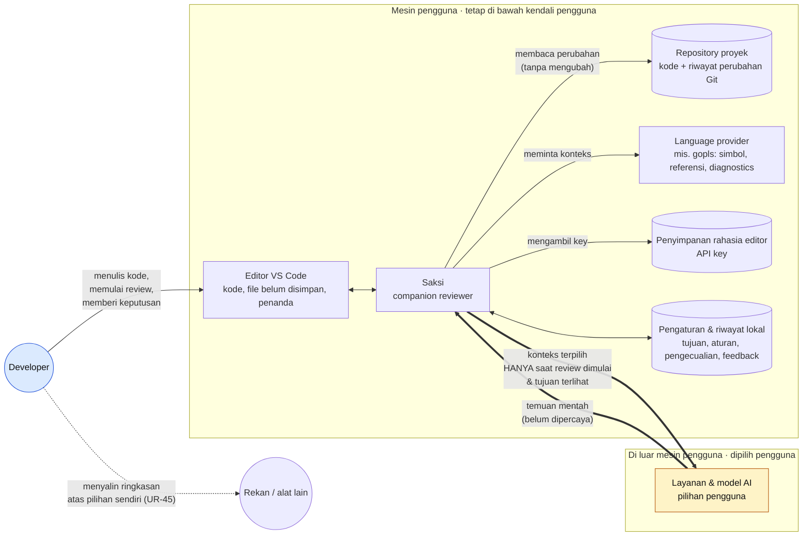

# 01 · Konteks Sistem

Gambaran siapa dan apa saja yang terlibat ketika Saksi dipakai, serta **batas kepercayaan**: apa yang tetap di mesin pengguna dan apa yang keluar ke layanan model.

## Poin penting

| Hubungan | Aturan dari requirement |
| --- | --- |
| Saksi → Repository | Hanya membaca. Tidak menyimpan, commit, atau mengubah kode tanpa tindakan pengguna (UR-28). |
| Saksi → Layanan model | Hanya saat pengguna memulai review/refinement/percakapan; tujuan dan cakupan pengiriman jelas (UR-36). Pengecualian dihormati di semua tahap (UR-37). |
| Layanan model → Saksi | Keluaran model **tidak dipercaya** sampai lokasi dan buktinya diperiksa terhadap kode yang direview (UR-17, bagian 8.3). |
| Pemilihan layanan | Tidak berpindah ke layanan lain diam-diam saat gagal (UR-04, UR-35). |
| API key | Tidak tampil di hasil review atau tampilan biasa; bisa diganti & dihapus (UR-03). |
| Ke pihak lain | Tidak ada pengiriman otomatis; menyalin ringkasan adalah pilihan pengguna (UR-45). |

> **MVP saat ini:** endpoint *chat-completions compatible* (HTTPS atau HTTP localhost), key di VS Code SecretStorage terikat ke URL endpoint, tanpa telemetry atau server Saksi.
