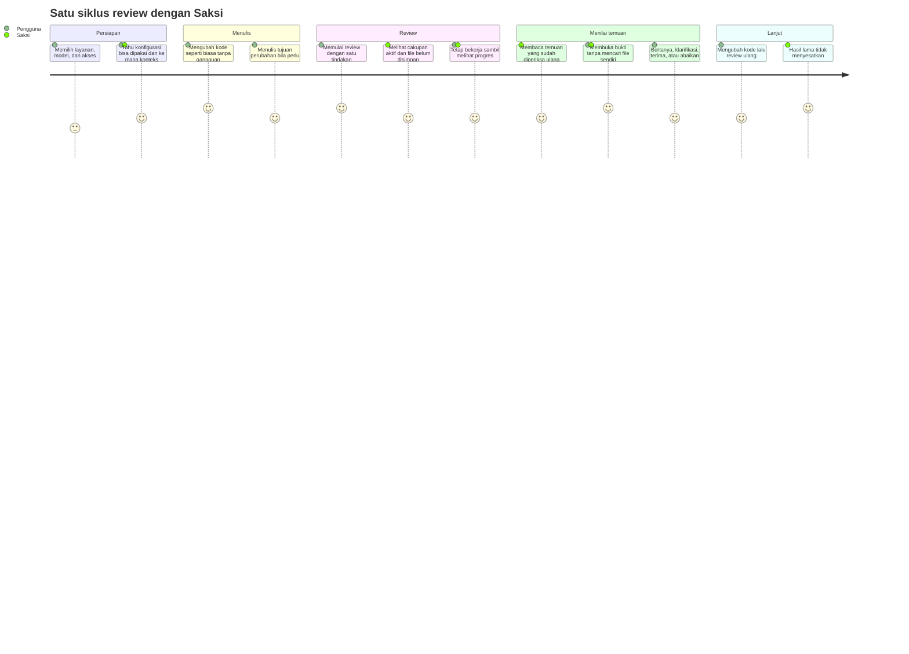
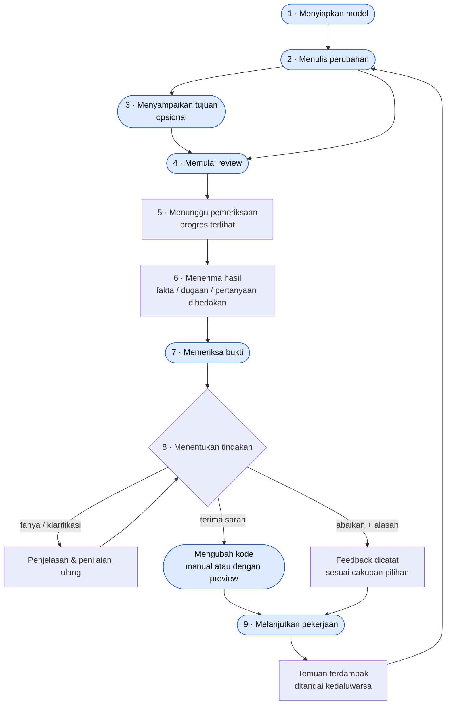

# 02 · Perjalanan Pengguna

Turunan dari bagian 5 dokumen requirement. Diagram pertama menunjukkan **perasaan yang dituju** di tiap langkah (skor 1–5 = target kenyamanan, bukan hasil pengukuran). Diagram kedua menunjukkan **siklus kerja** yang berulang.

## Journey

## Siklus kerja

| Langkah | Detail flow |
| --- | --- |
| 1 | [03 · Setup model](03-flow-setup-model.md) |
| 3–5 | [04 · Memulai review](04-flow-start-review.md), [05 · Pipeline](05-sequence-review-pipeline.md) |
| 6 | [06 · Refinement](06-flow-refinement.md) |
| 7–8 | [07 · Tindak lanjut](07-flow-finding-followup.md) |
| 9 | [08 · Status review](08-state-review-status.md), [09 · Siklus temuan](09-state-finding-lifecycle.md) |
