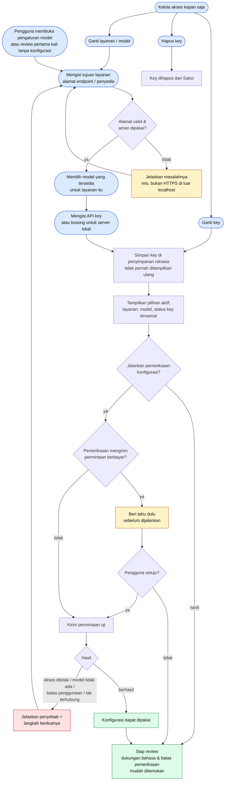

# 03 · Flow Setup Model

Cara pengguna menyiapkan layanan dan model AI pilihannya sendiri, lalu mengetahui apakah konfigurasi itu bisa diandalkan. Mencakup **UR-01–UR-05** dan skenario **UA-01**.

## Aturan yang terlihat di flow

| Titik | Requirement |
| --- | --- |
| Pilih layanan & model, tahu kombinasi didukung | UR-01 |
| Pemeriksaan konfigurasi, peringatan bila berbayar | UR-02 |
| Key tidak tampil, bisa diganti/dihapus | UR-03 |
| Pilihan aktif terlihat, tidak pindah layanan diam-diam | UR-04 |
| Dukungan bahasa & batas pemeriksaan mudah ditemukan | UR-05 |

> **MVP saat ini:** perintah *Configure Model Endpoint* meminta URL lengkap, model ID, dan key. Endpoint/model hanya dibaca dari User Settings agar workspace tidak bisa mengalihkan tujuan request. Belum ada pemeriksaan konfigurasi terpisah.
