# 04 · Flow Memulai Review

Apa yang dialami pengguna dari menekan tombol/shortcut sampai konteks benar-benar dikirim. Mencakup **UR-06–UR-15** dan **UR-36–UR-39**, skenario **UA-02, UA-03, UA-04, UA-05, UA-20, UA-23**.

```mermaid
flowchart TD
    trigger(["Pengguna memulai review<br/>perintah · tombol panel · shortcut"]) --> cfg{"Model sudah<br/>dikonfigurasi?"}
    cfg -- "belum" --> setup["Arahkan ke setup model<br/>lihat flow 03"]
    cfg -- "sudah" --> proj{"Lebih dari satu<br/>proyek terbuka?"}
    proj -- "ya" --> choose(["Pilih / konfirmasi proyek<br/>default: proyek file aktif"])
    proj -- "tidak" --> intent
    choose --> intent["Ambil tujuan perubahan aktif<br/>sama untuk semua cara memulai"]
    intent --> rules["Ambil aturan proyek aktif<br/>& pengecualian proyek ini saja"]
    rules --> scope["Tentukan cakupan<br/>default: perubahan tersimpan sejak commit terakhir<br/>+ file baru"]
    scope --> custom{"Pengguna memilih<br/>cakupan lain?"}
    custom -- "ya" --> narrow(["Pilih: seleksi kode · file ·<br/>staged · perbandingan lain"])
    narrow --> dirty
    custom -- "tidak" --> dirty{"Ada file<br/>belum disimpan?"}
    dirty -- "ya" --> ask(["Pilih: simpan · lewati ·<br/>pakai isi editor bila didukung"])
    ask --> changes
    dirty -- "tidak" --> changes{"Ada perubahan<br/>dalam cakupan?"}
    changes -- "tidak" --> empty["Status: belum ada perubahan<br/>sarankan ubah cakupan / simpan"]
    changes -- "ya" --> ctx["Kumpulkan konteks<br/>pemanggil, penggunaan terkait,<br/>penghapusan, rename"]
    ctx --> excl["Terapkan pengecualian<br/>& batas ukuran<br/>catat file dilewati + alasannya"]
    excl --> sens{"Informasi sensitif<br/>teridentifikasi?"}
    sens -- "ya" --> sensask(["Tinjau: hentikan · sesuaikan cakupan ·<br/>lanjut tanpa melewati pengecualian"])
    sensask -- "hentikan" --> stopped["Review tidak dikirim"]
    sensask -- "sesuaikan" --> excl
    sensask -- "lanjut" --> preview
    sens -- "tidak" --> preview{"Perlu pratinjau?<br/>pertama kali / tujuan atau<br/>cakupan berubah / diminta"}
    preview -- "ya" --> show(["Pratinjau: layanan tujuan,<br/>file disertakan & dilewati"])
    show -- "batal" --> stopped
    show -- "kirim" --> send
    preview -- "tidak" --> send["Kirim ke layanan pilihan<br/>status: sedang berjalan<br/>lihat sequence 05"]

    classDef user fill:#dbeafe,stroke:#1d4ed8,color:#111
    classDef warn fill:#fef3c7,stroke:#b45309,color:#111
    classDef stop fill:#fee2e2,stroke:#b91c1c,color:#111
    class trigger,choose,narrow,ask,sensask,show user
    class empty,excl warn
    class stopped stop
```

## Catatan per titik keputusan

| Titik | Yang harus terlihat pengguna | Requirement |
| --- | --- | --- |
| Cara memulai | Perintah, tombol, shortcut memberi hasil yang sama; shortcut bisa diganti (Ctrl+I bila dipilih), benturan dijelaskan. | UR-06, UR-07, UA-02 |
| Tujuan perubahan | Opsional, bisa diubah/dikosongkan, berlaku sama di semua jalur. | UR-08 |
| Aturan proyek | Bisa dilihat, diubah, dinonaktifkan; tidak bocor ke proyek lain. | UR-09, UA-20 |
| Cakupan | Dijelaskan tanpa istilah Git; ringkasan tersedia. | UR-11, UR-13 |
| File belum disimpan | Selalu ditanyakan/terlihat; tidak ada auto-save. | UR-12, UA-03 |
| Konteks lintas file | Pemanggil, penghapusan, rename dipertimbangkan, atau batasnya dijelaskan. | UR-14, UA-04 |
| Batas konteks | File disertakan/dilewati beserta alasan dapat diperiksa. | UR-15, UR-37 |
| Informasi sensitif | Kesempatan berhenti/menyesuaikan; tidak mengklaim deteksi sempurna. | UR-38, UA-23 |
| Pratinjau | Tersedia, tapi tidak diminta berulang tanpa perubahan relevan. | UR-36, UR-39 |

> **MVP saat ini:** cakupan tetap *saved working tree vs HEAD* (staged + unstaged + untracked). File belum disimpan otomatis **dilewati** dan dicatat. File dihapus dicatat sebagai dilewati. Filter nama file sensitif ada, tapi bukan pemindai rahasia. Belum ada pratinjau konteks.
