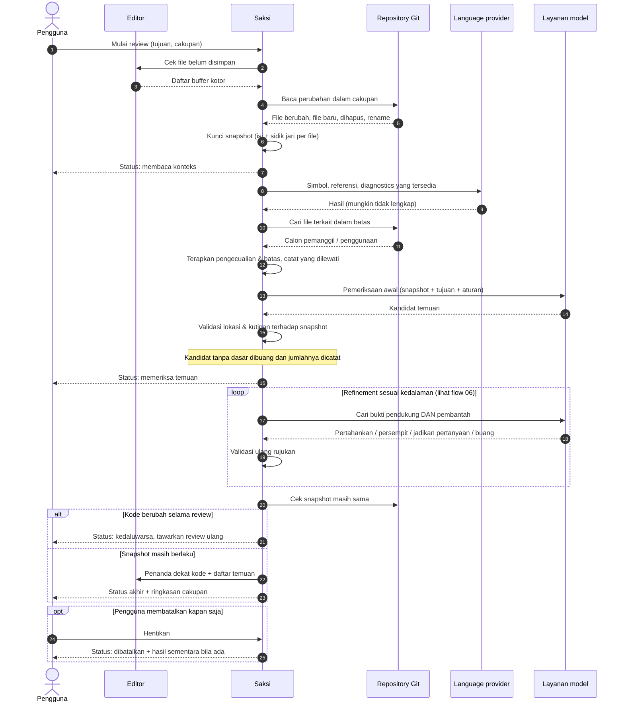

# 05 · Sequence Pipeline Review

Urutan interaksi dari review dimulai sampai temuan tampil. Diagram ini memperlihatkan **di mana kepercayaan dibangun**: snapshot dikunci, keluaran model diperiksa terhadap snapshot, lalu diperiksa ulang (refinement) sebelum menjadi hasil akhir. Mencakup **UR-14–UR-23, UR-31, UR-33**.

## Lapisan kepercayaan

| Lapisan | Tujuan | Requirement |
| --- | --- | --- |
| Snapshot dikunci | Bukti selalu menunjuk kode pada kondisi yang benar-benar direview. | UR-17, UR-33 |
| Konteks lintas file | Pemanggil/penggunaan dipertimbangkan; ketidaklengkapan dicatat, bukan disembunyikan. | UR-14, UR-15 |
| Validasi rujukan | Lokasi harus ada & relevan dengan perubahan; kutipan cocok dengan kode. Kutipan cocok **tidak** membuktikan kesimpulan. | UR-16, UR-17, bagian 8.3 |
| Refinement | Mencari bukti pembantah; temuan boleh dibatalkan. | UR-21–UR-23 |
| Cek akhir snapshot | Hasil tidak ditampilkan untuk kode yang sudah berubah. | UR-33 |
| Status jelas | Berjalan / selesai / sebagian / gagal / dibatalkan / kedaluwarsa dibedakan. | UR-31 |

> **MVP saat ini:** langkah 1–16 dan cek akhir snapshot sudah ada (snapshot di-hash, kutipan harus cocok dengan baris utuh, lokasi harus bersinggungan dengan hunk). Loop refinement belum ada. Konteks language provider dibatasi ±6,5 detik / 10 simbol; Go mendapat pencarian nama tekstual tambahan.
