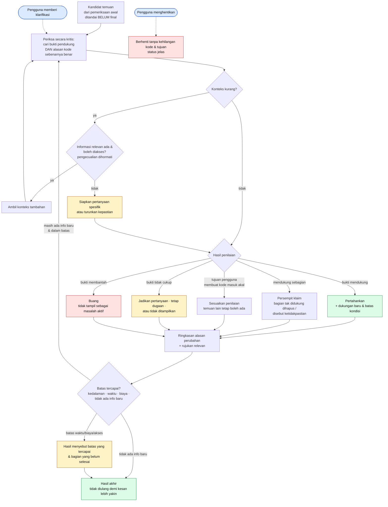
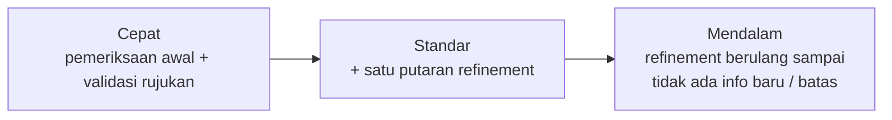

# 06 · Flow Refinement

Refinement = memeriksa dan memperbaiki **hasil review** berdasarkan bukti, konteks, atau klarifikasi (bagian 9). Pengguna tidak perlu memahami proses internal model. Mencakup **UR-21–UR-25**, skenario **UA-05, UA-06, UA-10, UA-11, UA-16**.

## Hasil refinement yang sah (bagian 9.2)

| Keadaan | Hasil | Node |
| --- | --- | --- |
| Bukti tambahan mendukung | Dukungan baru + batas kondisi | `keep` |
| Bukti mendukung sebagian | Klaim dipersempit | `narrow` |
| Bukti membantah | Tidak tampil sebagai masalah aktif | `drop` |
| Tujuan pengguna membuat kode masuk akal | Penilaian disesuaikan | `adjust` |
| Bukti tidak cukup | Pertanyaan / tetap dugaan / tidak ditampilkan | `unsure` |
| Berhenti karena waktu/biaya/akses | Batas & bagian belum selesai disebut | `partial` |
| Tidak ada info baru | Tidak diulang terus | `final` |

## Pilihan kedalaman (UR-25, usulan)

Nama dan isi tingkat kedalaman masih keputusan terbuka (bagian 14). Yang wajib: pengguna paham pilihannya, bisa berhenti, dan tahu saat batas tercapai.

> **MVP saat ini:** belum ada refinement. Semua temuan AI berlabel *Dugaan AI* atau *Pertanyaan*, dan temuan dengan rujukan tidak valid dibuang.
