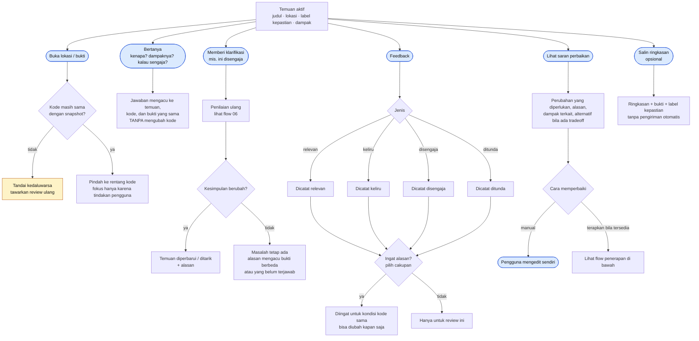
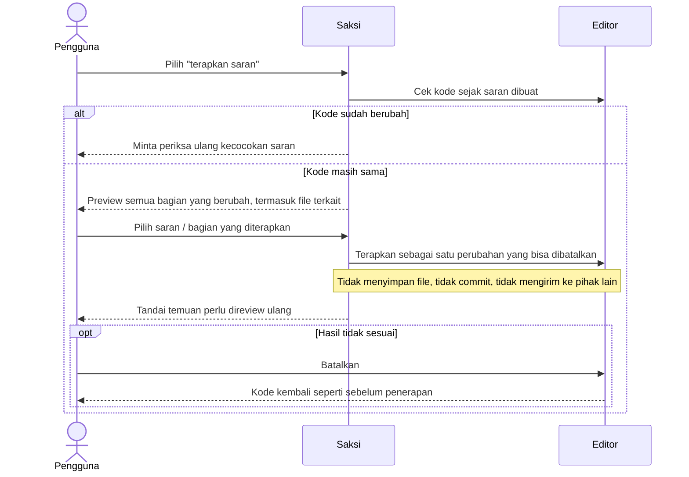

# 07 · Flow Tindak Lanjut Temuan

Apa yang bisa dilakukan pengguna setelah melihat temuan: membuka bukti, bertanya, memberi klarifikasi, memberi feedback, dan (bila tersedia) menerapkan saran dengan preview serta pembatalan. Mencakup **UR-24–UR-30, UR-41–UR-43, UR-45**, skenario **UA-12, UA-13, UA-14, UA-19, UA-22**.

## Ringkasan pilihan

## Penerapan saran (UR-29, UR-30)

| Aturan | Requirement |
| --- | --- |
| Pertanyaan dijawab dalam konteks temuan yang sama | UR-26, UA-13 |
| Saran menjelaskan tujuan, konsekuensi, alternatif | UR-27 |
| Review, penjelasan, refinement tidak mengubah/menyimpan/commit kode | UR-28 |
| Preview sebelum penerapan, termasuk file terkait | UR-29, UA-14 |
| Penerapan bisa dibatalkan; cek ulang bila kode berubah | UR-30 |
| Feedback tidak menyamakan "abaikan" dengan "AI salah"; bisa diubah | UR-41 |
| Alasan pengabaian diingat dalam cakupan pilihan | UR-42, UA-19 |
| Salin ringkasan tanpa pengiriman otomatis | UR-45, UA-22 |

> **MVP saat ini:** tersedia *Lihat bukti* dan *Abaikan temuan ini* (Quick Fix & panel). Abaikan hanya menyembunyikan untuk review itu. Belum ada percakapan, klarifikasi per temuan, feedback berlabel, atau penerapan saran.
