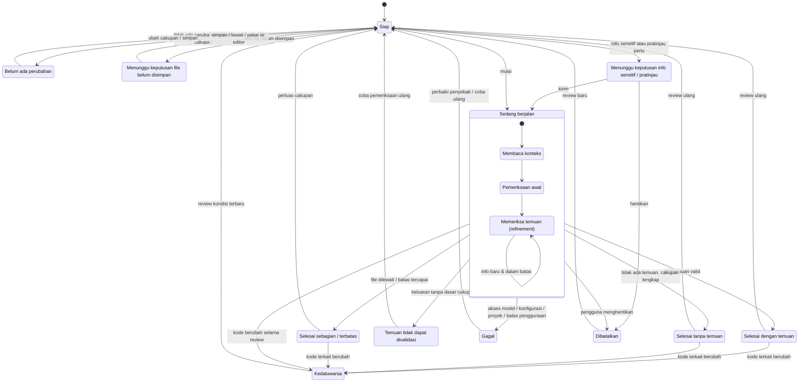

# 08 · State Status Review

Semua status yang harus bisa dibedakan pengguna **dalam teks yang jelas** (bukan hanya warna/ikon). Diturunkan dari bagian 10 dokumen requirement. Mencakup **UR-31–UR-35**, skenario **UA-15, UA-16, UA-17, UA-18**.

## Arti tiap status bagi pengguna

| Status | Yang harus jelas | Tindakan tersedia | Jangan sampai |
| --- | --- | --- | --- |
| Belum ada perubahan | Tidak ada cakupan yang sesuai pilihan saat ini. | Ubah cakupan, simpan, lanjut menulis. | Terlihat seperti "review bersih". |
| Menunggu file belum disimpan | Isi editor bisa berbeda dari yang diperiksa. | Simpan / lewati / pakai isi editor. | Auto-save diam-diam. |
| Sedang berjalan | Belum ada kesimpulan akhir; sub-tahap terlihat. | Tetap bekerja, lihat progres, hentikan. | Temuan sementara tampak final. |
| Selesai dengan temuan | Ada hal untuk dinilai pada cakupan yang berhasil diperiksa. | Buka bukti, tanya, feedback, perbaiki. | — |
| Selesai tanpa temuan | Tidak ada temuan **dalam cakupan yang berhasil diperiksa**. | Lanjut kerja dengan paham batasnya. | Klaim "proyek bebas bug" (UR-32). |
| Sebagian / terbatas | Ada perubahan/konteks relevan yang tidak ikut. | Lihat yang dilewati, perluas cakupan. | Ditampilkan sama dengan selesai penuh (UA-18). |
| Tidak dapat divalidasi | Keluaran tidak punya dasar cukup. | Coba pemeriksaan ulang. | Dianggap "tidak ada masalah". |
| Gagal | Pemeriksaan tidak selesai; bukan hasil bersih. | Perbaiki penyebab, coba ulang. | Ganti layanan diam-diam (UR-35). |
| Dibatalkan | Proses dihentikan pengguna/kondisi. | Lihat hasil sementara, review baru. | Kehilangan kode atau tujuan. |
| Kedaluwarsa | Hasil mungkin tak berlaku untuk kode sekarang. | Buka konteks lama berlabel, review terbaru. | Lokasi lama dipakai sebagai bukti berlaku (UR-33). |

> Status *Proyek tanpa riwayat perubahan* (bagian 10) diperlakukan sebagai variasi cakupan di flow 04: perbandingan tidak tersedia, pengguna memilih pemeriksaan kode yang didukung atau menerima batasnya.

> **MVP saat ini:** fase `idle · loading · done · empty · error · stale`. Status "sebagian" dan "tidak dapat divalidasi" muncul sebagai catatan di panel, belum status tersendiri. Perubahan file apa pun dalam repo membuat **seluruh** hasil `stale`.
