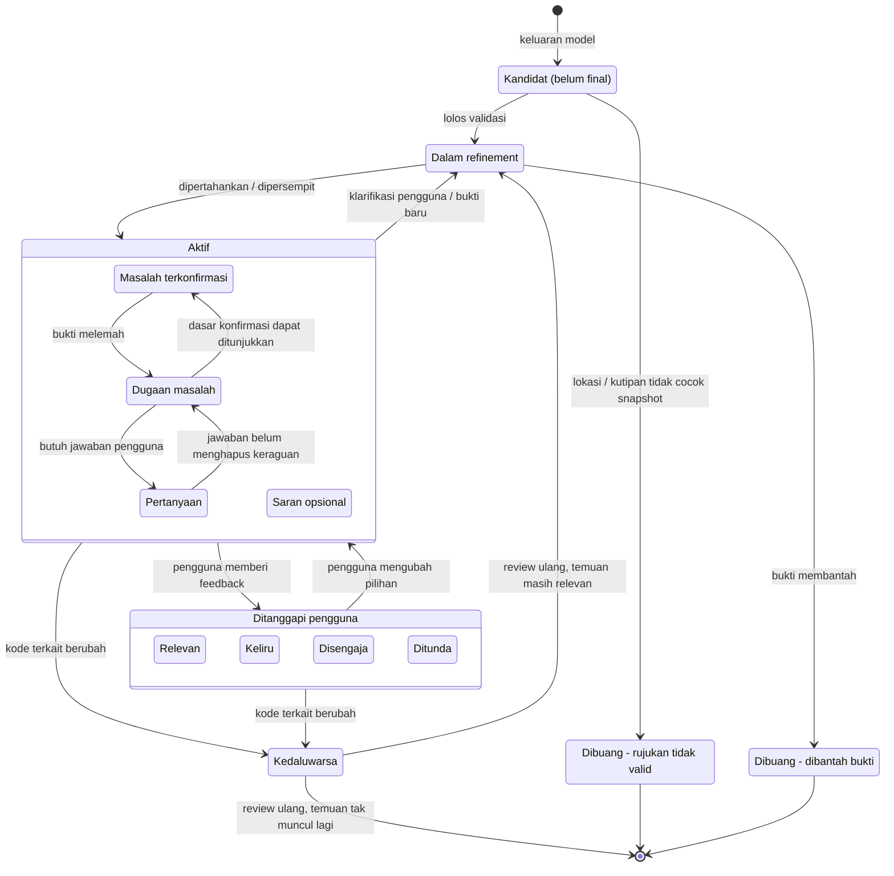
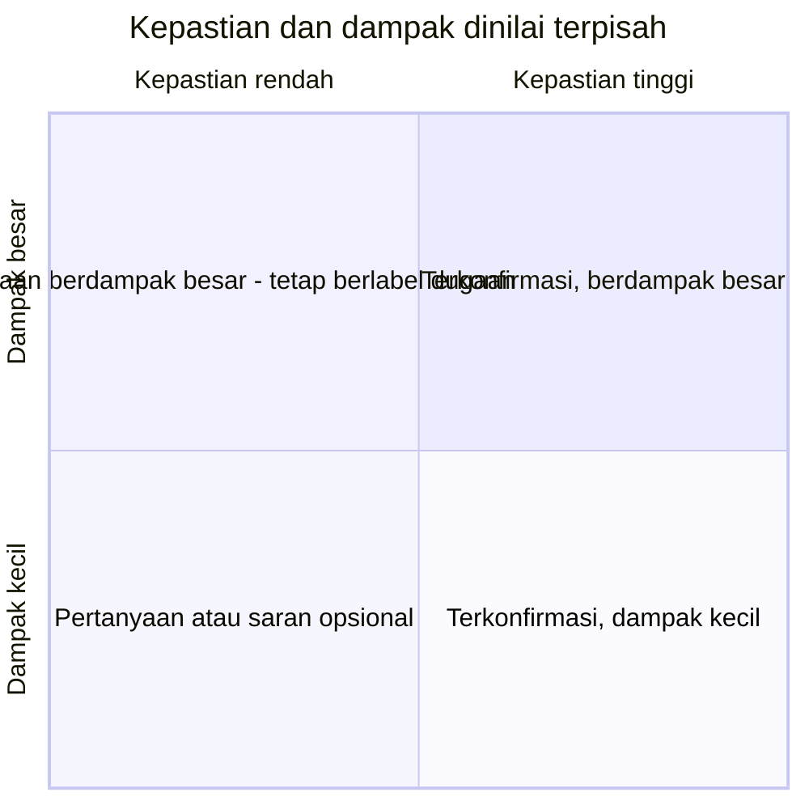

# 09 · Siklus Hidup Temuan

Satu temuan melewati beberapa keadaan: dari kandidat mentah, divalidasi, diperiksa ulang, diberi label, ditanggapi pengguna, sampai kedaluwarsa. **Label kepastian** dan **tingkat dampak** adalah dua sumbu terpisah. Mencakup **UR-16–UR-24, UR-33, UR-34, UR-41, UR-42**.

## Siklus

## Dua sumbu: kepastian vs dampak

Label dampak **tidak boleh** mengubah dugaan menjadi masalah terkonfirmasi (UR-19, UA-09). Persentase keyakinan tidak diperlukan; penjelasan bukti dan batasnya lebih penting (bagian 8.2).

## Isi temuan (bagian 8.1)

| Informasi | Tampil ringkas | Tampil detail |
| --- | --- | --- |
| Judul singkat | ✔ | ✔ |
| Lokasi tepat (simbol/ekspresi/baris) | ✔ | ✔ |
| Label kepastian | ✔ | ✔ |
| Tingkat dampak + alasan | ✔ | ✔ |
| Pengamatan (yang terlihat di kode) | | ✔ |
| Dampak & kondisi | | ✔ |
| Bukti yang dapat dibuka (termasuk file lain) | | ✔ |
| Konteks yang kurang / asumsi | | ✔ |
| Saran tindakan + konsekuensi | | ✔ |
| Tanggapan pengguna | ✔ (aksi) | ✔ |
| Riwayat perubahan penilaian (refinement) | | ✔ |

> **MVP saat ini:** `kind` hanya `concern` (Dugaan AI) atau `question` (Pertanyaan); model tidak bisa menyatakan terverifikasi. Belum ada sumbu dampak, refinement, atau feedback berlabel. Duplikat (lokasi + judul sama) digabung.
