# 10 · ERD Konseptual

Model data **konseptual**: informasi yang dikenal dan dibicarakan pengguna, serta hubungannya. Ini **bukan** desain database atau struktur penyimpanan (yang secara eksplisit di luar cakupan dokumen requirement, bagian 4). Tujuannya menyamakan istilah dan memastikan setiap requirement punya "tempat" informasinya.

```mermaid
erDiagram
    PENGGUNA ||--o{ KONFIGURASI_MODEL : "memiliki"
    PENGGUNA ||--|| PREFERENSI : "mengatur"
    PENGGUNA ||--o{ PROYEK : "membuka"
    KONFIGURASI_MODEL ||--o| AKSES_MODEL : "memakai"

    PROYEK ||--o{ ATURAN_PROYEK : "punya"
    PROYEK ||--o{ PENGECUALIAN : "punya"
    PROYEK ||--o{ SESI_REVIEW : "direview dalam"
    PROYEK ||--o{ INGATAN_FEEDBACK : "menyimpan"

    KONFIGURASI_MODEL ||--o{ SESI_REVIEW : "dipakai oleh"
    TUJUAN_PERUBAHAN |o--o{ SESI_REVIEW : "berlaku pada"
    SESI_REVIEW ||--|| CAKUPAN : "menentukan"
    SESI_REVIEW ||--|| SNAPSHOT : "memeriksa"
    SESI_REVIEW ||--o{ TAHAP_PEMERIKSAAN : "terdiri dari"
    SESI_REVIEW ||--o{ TEMUAN : "menghasilkan"
    SESI_REVIEW ||--o{ PERINGATAN_SENSITIF : "memunculkan"
    SESI_REVIEW ||--o| PENGGUNAAN_MODEL : "mencatat"

    CAKUPAN ||--o{ ITEM_KONTEKS : "berisi"
    SNAPSHOT ||--|{ FILE_SNAPSHOT : "berisi"
    ITEM_KONTEKS }o--o| FILE_SNAPSHOT : "menjadi"

    TEMUAN ||--|{ BUKTI : "didukung"
    BUKTI }o--|| FILE_SNAPSHOT : "merujuk"
    TEMUAN ||--o{ REVISI_TEMUAN : "berubah lewat"
    TAHAP_PEMERIKSAAN ||--o{ REVISI_TEMUAN : "menyebabkan"
    TEMUAN ||--o{ PESAN_PERCAKAPAN : "dibahas dalam"
    TEMUAN ||--o{ FEEDBACK : "ditanggapi"
    TEMUAN ||--o{ SARAN_PERBAIKAN : "menawarkan"
    SARAN_PERBAIKAN ||--o{ PENERAPAN_SARAN : "diterapkan sebagai"
    FEEDBACK |o--o| INGATAN_FEEDBACK : "diingat sebagai"

    PENGGUNA {
        string nama_tampilan
    }
    PREFERENSI {
        string gaya_penjelasan "ringkas | mendidik"
        string bahasa_penjelasan "default Indonesia"
        boolean tampilkan_saran_gaya
        boolean tampilkan_companion
        string shortcut_review "mis. Ctrl+I"
        string kedalaman_default
        boolean simpan_riwayat
    }
    KONFIGURASI_MODEL {
        string tujuan_layanan "alamat endpoint"
        string model
        string status_pemeriksaan "belum | berhasil | gagal"
        boolean aktif
    }
    AKSES_MODEL {
        string referensi_rahasia "key tidak pernah ditampilkan"
        datetime diperbarui
    }
    PROYEK {
        string nama
        string lokasi
        boolean punya_riwayat_perubahan
    }
    ATURAN_PROYEK {
        string isi
        boolean aktif
    }
    PENGECUALIAN {
        string pola_path
        string alasan
    }
    TUJUAN_PERUBAHAN {
        string teks "opsional, bisa dikosongkan"
    }
    SESI_REVIEW {
        datetime dimulai
        string status "lihat diagram 08"
        string kedalaman
        string ringkasan_batas
    }
    CAKUPAN {
        string jenis "tersimpan sejak commit | seleksi | file | staged | perbandingan"
        string perlakuan_file_belum_disimpan "simpan | lewati | isi editor"
    }
    ITEM_KONTEKS {
        string path
        string peran "berubah | terkait | dihapus | rename"
        boolean disertakan
        string alasan_dilewati
    }
    SNAPSHOT {
        string basis "mis. commit terakhir"
        datetime diambil
    }
    FILE_SNAPSHOT {
        string path
        string sidik_jari "untuk deteksi kedaluwarsa"
        string rentang_berubah
    }
    TAHAP_PEMERIKSAAN {
        string jenis "awal | refinement"
        string status "selesai | terhenti | gagal"
        string alasan_berhenti
    }
    TEMUAN {
        string judul
        string label_kepastian "terkonfirmasi | dugaan | pertanyaan | saran opsional"
        string tingkat_dampak "besar | sedang | kecil"
        string pengamatan
        string dampak_dan_kondisi
        string konteks_kurang
        string status "lihat diagram 09"
    }
    BUKTI {
        string lokasi "path + rentang"
        string kutipan
        string alasan
        boolean dapat_diperiksa
    }
    REVISI_TEMUAN {
        string hasil "dipertahankan | dipersempit | jadi pertanyaan | dibuang"
        string ringkasan_alasan
    }
    PESAN_PERCAKAPAN {
        string pengirim "pengguna | Saksi"
        string isi
        boolean klarifikasi
    }
    FEEDBACK {
        string jenis "relevan | keliru | disengaja | ditunda"
        string alasan
    }
    INGATAN_FEEDBACK {
        string cakupan_ingatan "pilihan pengguna"
        string kondisi_kode "sidik jari saat diingat"
    }
    SARAN_PERBAIKAN {
        string perubahan
        string alasan
        string konsekuensi
        string alternatif
    }
    PENERAPAN_SARAN {
        datetime diterapkan
        boolean dibatalkan
    }
    PERINGATAN_SENSITIF {
        string lokasi
        string keputusan_pengguna "hentikan | sesuaikan | lanjut"
    }
    PENGGUNAAN_MODEL {
        int jumlah_permintaan
        string estimasi_biaya "atau tidak tersedia"
    }
```

## Kamus entitas

| Entitas | Arti bagi pengguna | Requirement |
| --- | --- | --- |
| KONFIGURASI_MODEL / AKSES_MODEL | Layanan, model, dan key yang dipilih pengguna. | UR-01–04 |
| PREFERENSI | Gaya bantuan, bahasa, shortcut, companion, kedalaman, riwayat. | UR-07, UR-25, UR-44, UR-47 |
| PROYEK, ATURAN_PROYEK, PENGECUALIAN | Konteks dan batas per proyek; tidak bocor ke proyek lain. | UR-09, UR-15, UR-37, UA-20 |
| TUJUAN_PERUBAHAN | Niat pengguna yang belum terlihat dari kode. | UR-08 |
| SESI_REVIEW | Satu kali review beserta status dan batasnya. | UR-31, UR-32 |
| CAKUPAN, ITEM_KONTEKS | Apa yang diperiksa, apa yang dilewati, dan kenapa. | UR-11–15 |
| SNAPSHOT, FILE_SNAPSHOT | Kondisi kode yang benar-benar direview; dasar deteksi kedaluwarsa. | UR-17, UR-33 |
| TAHAP_PEMERIKSAAN, REVISI_TEMUAN | Pemeriksaan awal vs refinement, dan alasan perubahan penilaian. | UR-21–25 |
| TEMUAN, BUKTI | Isi temuan dan rujukan yang dapat dibuka. | UR-16–20, bagian 8 |
| PESAN_PERCAKAPAN | Tanya-jawab & klarifikasi yang terikat pada temuan. | UR-24, UR-26 |
| FEEDBACK, INGATAN_FEEDBACK | Tanggapan berlabel dan alasan yang diingat sesuai cakupan pilihan. | UR-41, UR-42 |
| SARAN_PERBAIKAN, PENERAPAN_SARAN | Saran, preview, penerapan, pembatalan. | UR-27, UR-29, UR-30 |
| PERINGATAN_SENSITIF | Info sensitif yang teridentifikasi dan keputusan pengguna. | UR-38 |
| PENGGUNAAN_MODEL | Penggunaan/estimasi biaya, atau penjelasan bila tidak tersedia. | UR-50 |

## Aturan data yang penting

- **Riwayat & feedback** hanya disimpan bila pengguna mengaktifkannya, dan dapat dihapus. Penghapusan di Saksi tidak diklaim menghapus data di layanan model (UR-40).
- **Feedback bukan izin** penggunaan data tambahan atau pelatihan model (UR-40).
- **Key** tidak pernah menjadi bagian dari temuan, riwayat, atau ringkasan yang disalin (UR-03).
- Data yang terikat **SNAPSHOT** dianggap berlaku hanya selama sidik jari file terkait sama (UR-33, UR-43).

> **MVP saat ini:** semua data hidup di memori selama satu sesi review (snapshot, findings, resultMeta), kecuali endpoint/model di User Settings dan key di SecretStorage. Belum ada riwayat atau feedback tersimpan.
