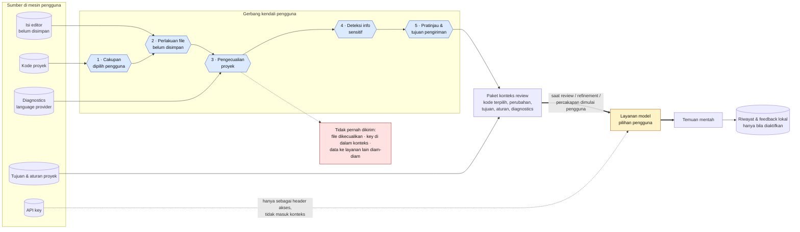
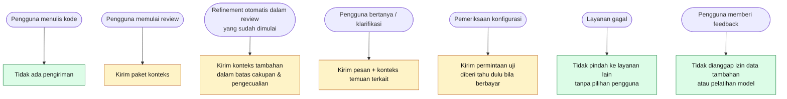

# 11 · Aliran Data & Privasi

Data apa yang keluar dari mesin pengguna, kapan, ke mana, dan titik kendali pengguna di sepanjang jalannya. Mencakup **UR-03, UR-36–UR-40**, skenario **UA-05, UA-23, UA-24**.

## Gerbang kendali

| Gerbang | Kendali pengguna | Requirement |
| --- | --- | --- |
| 1 · Cakupan | Memilih perubahan/file/seleksi yang direview. | UR-11, UR-13 |
| 2 · File belum disimpan | Simpan, lewati, atau pakai isi editor. | UR-12 |
| 3 · Pengecualian | Berlaku di pemeriksaan awal, refinement, percakapan, dan review ulang. | UR-37, UA-05 |
| 4 · Info sensitif | Bisa berhenti atau menyesuaikan; deteksi tidak dijanjikan sempurna. | UR-38, UA-23 |
| 5 · Pratinjau | Tujuan & isi pengiriman terlihat; tidak ditanyakan ulang tanpa perubahan relevan. | UR-36, UR-39 |

## Kapan data dikirim

## Riwayat & penghapusan (UR-40, UA-24)

| Data | Disimpan? | Bisa dihapus pengguna? | Catatan jujur |
| --- | --- | --- | --- |
| API key | Ya, di penyimpanan rahasia | Ya | Tidak pernah ditampilkan ulang. |
| Konfigurasi model & preferensi | Ya | Ya | — |
| Riwayat review & percakapan | Hanya bila diaktifkan | Ya | Menghapus di Saksi tidak menghapus data di layanan model. |
| Feedback & alasan pengabaian | Sesuai cakupan pilihan | Ya, dan bisa diubah | Bukan izin pelatihan model. |
| Data di layanan model | Bergantung kebijakan layanan | Di luar kendali Saksi | Harus dijelaskan, bukan dijanjikan. |

> **MVP saat ini:** yang dikirim: source + patch file terpilih, path relatif repo, diagnostics, tujuan perubahan. Gerbang 1 tetap (saved vs HEAD), gerbang 2 = selalu lewati, gerbang 3 = folder dependensi/build + nama file sensitif umum + `saksi.excludePaths`, gerbang 4 hanya filter nama file, gerbang 5 belum ada. Tidak ada telemetry; HTTP redirect tidak diikuti.
