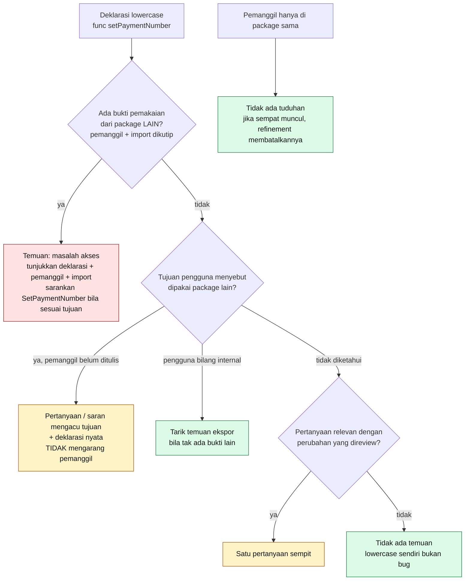

# 12 · Contoh Go: Akses Fungsi `setPaymentNumber`

Contoh utama di bagian 9.3. Diagram ini adalah **pohon keputusan perilaku yang dituju** reviewer, dipakai sebagai kasus uji pengalaman (UA-06, UA-07) — bukan hasil review langsung.

```go
func setPaymentNumber() {
    // Implementasi pengguna.
}
```

Aturan bahasa yang mendasari: nama lowercase di Go berarti **unexported** (tidak dapat diakses dari package lain), **bukan** private per file. Pemanggil di package yang sama tetap sah walau beda file.



## Pemetaan ke tabel bagian 9.3

| Konteks yang diketahui | Node | Label temuan |
| --- | --- | --- |
| Pemanggil di package yang sama | `same → none2` | Tidak ada (atau dibuang saat refinement) |
| Ada penggunaan dari package lain | `cross` | Masalah terkonfirmasi / dugaan, sesuai kekuatan bukti |
| Tujuan: dipakai package lain, pemanggil belum ada | `fut` | Pertanyaan atau saran |
| Tujuan & bukti lintas package tidak ada | `none` / `narrowq` | Tidak ada, atau pertanyaan bila relevan |
| Pengguna: sengaja internal | `internal` | Ditarik |

## Contoh penjelasan saat konteks belum cukup

> "Fungsi ini masih unexported. Kamu menyebut bahwa fungsi akan dipakai oleh package billing. Apakah kamu ingin menjadikannya SetPaymentNumber? Aku belum menemukan pemanggil lintas package dalam bagian proyek yang diperiksa."

Struktur kalimatnya memisahkan: **pengamatan** → **tujuan pengguna** → **pertanyaan** → **batas konteks**.

## Batas kepercayaan yang diuji contoh ini

- Kecocokan nama secara teks (`setPaymentNumber` vs `SetPaymentNumber`) adalah **petunjuk**, bukan bukti bahwa keduanya simbol yang sama.
- Tidak ditemukannya pemanggil **tidak** membuktikan fungsi tidak pernah dipanggil.
- Reviewer tidak bisa mengetahui pemanggil masa depan.

> **MVP saat ini:** aturan ini ditanam di system prompt; pencarian tekstual nama fungsi Go (lowercase & versi kapital) dipakai untuk menemukan calon file terkait.
