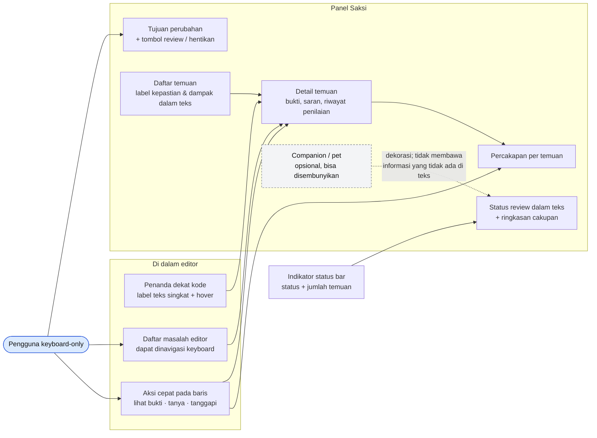
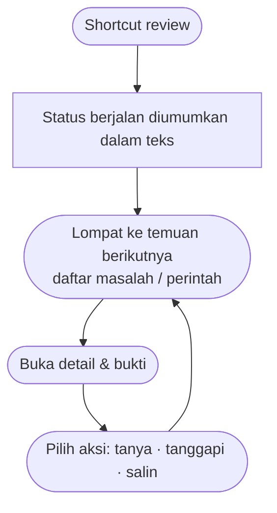

# 13 · Interaksi Companion

Permukaan tempat pengguna berinteraksi dengan Saksi di dalam editor, dan bagaimana fungsi inti tetap bisa dipakai **tanpa pet, tanpa mouse, dan tanpa bergantung pada warna/animasi**. Mencakup **UR-44, UR-46–UR-50**, skenario **UA-21, UA-22**.

## Aturan interaksi

| Aturan | Requirement |
| --- | --- |
| Temuan, bukti, dan rujukan mudah dijangkau dari editor; fokus hanya pindah karena tindakan pengguna. | UR-46 |
| Pet/maskot bisa disembunyikan tanpa kehilangan fungsi; tidak menutupi kode penting. | UR-47, UA-21 |
| Bahasa jelas, spesifik, tidak menghakimi; pilihan disengaja diakui. | UR-48 |
| Semua fungsi inti bisa dengan keyboard; status punya arti dalam teks. | UR-49, UA-21 |
| Bisa membatasi gangguan, menghentikan review, melihat penggunaan/estimasi biaya (atau penjelasan bila tidak tersedia). | UR-50 |
| Gaya penjelasan ringkas/mendidik, bahasa penjelasan, saran gaya on/off; identifier kode tidak diterjemahkan. | UR-44, UA-22 |

## Alur keyboard-only (UA-21)

> **MVP saat ini:** penanda inline (annotation + hover), Problems panel, Quick Fix *Lihat bukti / Abaikan*, status bar `Saksi · n`, panel webview dengan burung hantu statis (CSS). Belum ada percakapan, opsi menyembunyikan pet, gaya penjelasan, atau info biaya.
