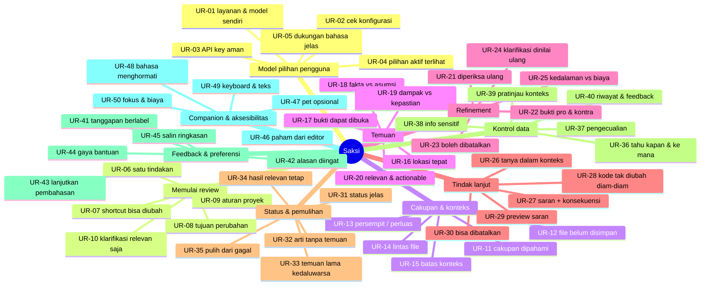
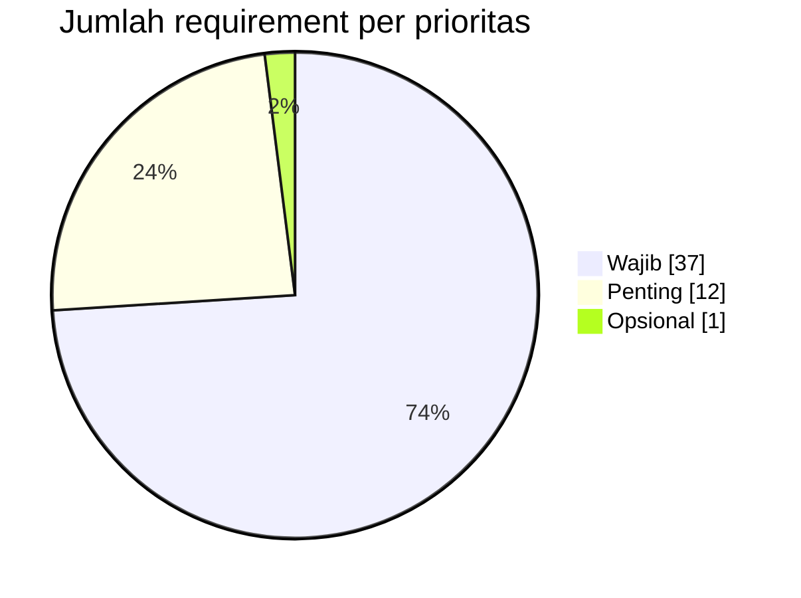
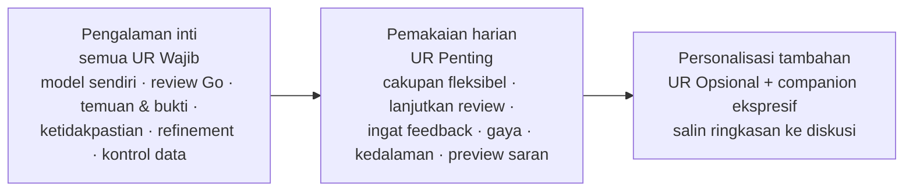

# 14 · Peta Requirement

Pengelompokan 50 kebutuhan pengguna per area (bagian 7) dan prioritasnya (bagian 6), lalu urutan manfaat per tahap rilis (bagian 13).

## Mindmap area

## Prioritas per area

| Area | Wajib | Penting | Opsional |
| --- | --- | --- | --- |
| 7.1 Model pilihan pengguna | UR-01, 02, 03, 04, 05 | — | — |
| 7.2 Memulai review | UR-06, 07, 08, 10 | UR-09 | — |
| 7.3 Cakupan & konteks | UR-11, 12, 14, 15 | UR-13 | — |
| 7.4 Temuan | UR-16, 17, 18, 19, 20 | — | — |
| 7.5 Refinement | UR-21, 22, 23, 24 | UR-25 | — |
| 7.6 Tindak lanjut | UR-26, 27, 28 | UR-29, 30 | — |
| 7.7 Status & pemulihan | UR-31, 32, 33, 35 | UR-34 | — |
| 7.8 Kontrol data | UR-36, 37, 38, 40 | UR-39 | — |
| 7.9 Feedback & preferensi | UR-41 | UR-42, 43, 44 | UR-45 |
| 7.10 Companion & aksesibilitas | UR-46, 48, 49 | UR-47, 50 | — |
| **Total** | **37** | **12** | **1** |

## Tahap rilis (bagian 13, usulan urutan manfaat)

Bukan estimasi jadwal. Setiap tahap tidak boleh mengurangi kejelasan bukti, kontrol pengguna, atau aksesibilitas.
