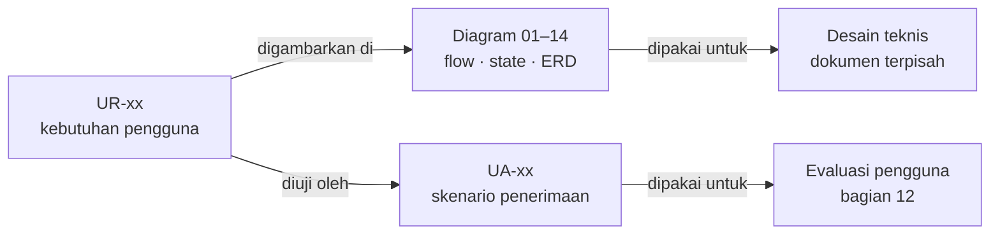

# 15 · Traceability

Matriks yang menghubungkan setiap kebutuhan pengguna (`UR`) dengan diagram yang menggambarkannya dan skenario penerimaan (`UA`) yang mengujinya. Kolom UA diambil langsung dari kolom *Requirement terkait* di bagian 11 [`user_requirement.md`](../user_requirement.md).

## Alur hubungan dokumen

## Matriks UR → diagram → UA

| UR | Prioritas | Kebutuhan pengguna | Diagram | Skenario UA |
| --- | --- | --- | --- | --- |
| UR-01 | Wajib | Saya dapat memakai layanan dan model AI pilihan saya sendiri. | [03](03-flow-setup-model.md), [10](10-erd-conceptual.md) | UA-01 |
| UR-02 | Wajib | Saya dapat mengetahui apakah konfigurasi saya bisa digunakan sebelum mengandalkannya untuk review. | [03](03-flow-setup-model.md), [10](10-erd-conceptual.md) | UA-01 |
| UR-03 | Wajib | Saya dapat mengelola akses model tanpa mengekspos API key secara tidak sengaja. | [01](01-system-context.md), [03](03-flow-setup-model.md), [10](10-erd-conceptual.md), [11](11-data-flow-privacy.md) | UA-01, UA-24 |
| UR-04 | Wajib | Saya dapat mengetahui model dan layanan yang sedang digunakan. | [01](01-system-context.md), [03](03-flow-setup-model.md), [10](10-erd-conceptual.md) | UA-01, UA-17 |
| UR-05 | Wajib | Saya mengetahui jenis kode dan pemeriksaan yang dapat dibantu Saksi. | [03](03-flow-setup-model.md) | — |
| UR-06 | Wajib | Saya dapat memulai review melalui satu tindakan dari editor. | [04](04-flow-start-review.md) | UA-02 |
| UR-07 | Wajib | Saya dapat memakai shortcut yang sesuai kebiasaan kerja saya, termasuk Ctrl+I jika saya memilihnya. | [04](04-flow-start-review.md), [10](10-erd-conceptual.md) | UA-02 |
| UR-08 | Wajib | Saya dapat menjelaskan tujuan perubahan tanpa diwajibkan menulisnya setiap kali review. | [04](04-flow-start-review.md), [10](10-erd-conceptual.md) | UA-02, UA-07 |
| UR-09 | Penting | Saya dapat memberi aturan dan konteks proyek yang relevan. | [04](04-flow-start-review.md), [10](10-erd-conceptual.md) | UA-20 |
| UR-10 | Wajib | Saya hanya diminta klarifikasi yang memang berpengaruh pada penilaian. | [04](04-flow-start-review.md) | UA-11 |
| UR-11 | Wajib | Saya memahami perubahan mana yang direview tanpa harus mengetahui perintah Git. | [04](04-flow-start-review.md), [10](10-erd-conceptual.md), [11](11-data-flow-privacy.md) | UA-03, UA-04 |
| UR-12 | Wajib | Saya mengetahui bagaimana file yang belum disimpan diperlakukan. | [04](04-flow-start-review.md), [10](10-erd-conceptual.md), [11](11-data-flow-privacy.md) | UA-03 |
| UR-13 | Penting | Saya dapat mempersempit atau memperluas cakupan sesuai pekerjaan. | [04](04-flow-start-review.md), [10](10-erd-conceptual.md), [11](11-data-flow-privacy.md) | — |
| UR-14 | Wajib | Saya mendapat review yang mempertimbangkan konteks lintas file dan perubahan selain penambahan baris. | [04](04-flow-start-review.md), [05](05-sequence-review-pipeline.md), [10](10-erd-conceptual.md) | UA-04, UA-06 |
| UR-15 | Wajib | Saya dapat mengetahui dan mengendalikan batas konteks review. | [04](04-flow-start-review.md), [05](05-sequence-review-pipeline.md), [10](10-erd-conceptual.md) | UA-03, UA-04, UA-18, UA-20 |
| UR-16 | Wajib | Saya dapat langsung melihat bagian kode yang dipersoalkan. | [05](05-sequence-review-pipeline.md), [09](09-state-finding-lifecycle.md), [10](10-erd-conceptual.md) | UA-08 |
| UR-17 | Wajib | Saya dapat membuka bukti yang mendasari temuan, termasuk bukti dari file lain. | [01](01-system-context.md), [05](05-sequence-review-pipeline.md), [09](09-state-finding-lifecycle.md), [10](10-erd-conceptual.md) | UA-07, UA-08 |
| UR-18 | Wajib | Saya dapat membedakan pengamatan, kesimpulan, asumsi, dan informasi yang belum diketahui. | [05](05-sequence-review-pipeline.md), [09](09-state-finding-lifecycle.md), [10](10-erd-conceptual.md) | UA-06, UA-07, UA-08, UA-09, UA-11 |
| UR-19 | Wajib | Saya memahami tingkat dampak dan tingkat kepastian sebagai dua hal berbeda. | [05](05-sequence-review-pipeline.md), [09](09-state-finding-lifecycle.md), [10](10-erd-conceptual.md) | UA-09, UA-11 |
| UR-20 | Wajib | Saya mendapat temuan yang relevan dan dapat ditindaklanjuti. | [05](05-sequence-review-pipeline.md), [09](09-state-finding-lifecycle.md), [10](10-erd-conceptual.md) | UA-06 |
| UR-21 | Wajib | Saya menerima temuan yang telah diperiksa ulang sesuai kedalaman review yang dipilih. | [05](05-sequence-review-pipeline.md), [06](06-flow-refinement.md), [09](09-state-finding-lifecycle.md), [10](10-erd-conceptual.md) | UA-10 |
| UR-22 | Wajib | Saya mendapat pemeriksaan tambahan yang mencari bukti pendukung sekaligus bukti pembantah. | [05](05-sequence-review-pipeline.md), [06](06-flow-refinement.md), [09](09-state-finding-lifecycle.md), [10](10-erd-conceptual.md) | UA-05, UA-06, UA-10 |
| UR-23 | Wajib | Saya dapat melihat temuan diperbaiki atau dibatalkan ketika bukti berubah. | [05](05-sequence-review-pipeline.md), [06](06-flow-refinement.md), [09](09-state-finding-lifecycle.md), [10](10-erd-conceptual.md) | UA-06, UA-10, UA-11 |
| UR-24 | Wajib | Saya dapat memberi klarifikasi dan memperoleh penilaian ulang yang mempertimbangkannya. | [06](06-flow-refinement.md), [07](07-flow-finding-followup.md), [09](09-state-finding-lifecycle.md), [10](10-erd-conceptual.md) | UA-12 |
| UR-25 | Penting | Saya dapat menyeimbangkan kedalaman review dengan waktu dan biaya. | [06](06-flow-refinement.md), [07](07-flow-finding-followup.md), [10](10-erd-conceptual.md) | UA-16 |
| UR-26 | Wajib | Saya dapat bertanya tentang suatu temuan dengan konteks yang tetap terjaga. | [07](07-flow-finding-followup.md), [10](10-erd-conceptual.md) | UA-12, UA-13 |
| UR-27 | Wajib | Saya mendapat saran perbaikan yang menjelaskan tujuan dan konsekuensinya. | [07](07-flow-finding-followup.md), [10](10-erd-conceptual.md) | UA-07, UA-13, UA-14 |
| UR-28 | Wajib | Saya tetap mengendalikan kapan kode atau pekerjaan saya diubah. | [01](01-system-context.md), [07](07-flow-finding-followup.md) | UA-13, UA-22 |
| UR-29 | Penting | Saya dapat meninjau perubahan yang disarankan sebelum menerapkannya. | [07](07-flow-finding-followup.md), [10](10-erd-conceptual.md) | UA-14 |
| UR-30 | Penting | Saya dapat memulihkan pekerjaan setelah menerapkan saran yang tidak sesuai. | [07](07-flow-finding-followup.md), [10](10-erd-conceptual.md) | UA-14 |
| UR-31 | Wajib | Saya mengetahui apakah review berjalan, selesai, terbatas, gagal, dibatalkan, atau sudah kedaluwarsa. | [05](05-sequence-review-pipeline.md), [08](08-state-review-status.md), [10](10-erd-conceptual.md) | UA-15, UA-16, UA-17, UA-18 |
| UR-32 | Wajib | Saya memahami arti hasil tanpa temuan. | [08](08-state-review-status.md), [10](10-erd-conceptual.md) | UA-18 |
| UR-33 | Wajib | Saya tidak diarahkan oleh temuan lama yang sudah tidak sesuai kode saat ini. | [05](05-sequence-review-pipeline.md), [08](08-state-review-status.md), [09](09-state-finding-lifecycle.md), [10](10-erd-conceptual.md) | UA-15 |
| UR-34 | Penting | Saya dapat melanjutkan pekerjaan tanpa kehilangan review yang masih relevan. | [08](08-state-review-status.md), [09](09-state-finding-lifecycle.md) | UA-15 |
| UR-35 | Wajib | Saya dapat pulih dari kegagalan tanpa menebak langkah berikutnya. | [01](01-system-context.md), [08](08-state-review-status.md) | UA-17 |
| UR-36 | Wajib | Saya mengetahui kapan konteks proyek akan dikirim dan ke layanan mana. | [01](01-system-context.md), [04](04-flow-start-review.md), [11](11-data-flow-privacy.md) | UA-05, UA-23 |
| UR-37 | Wajib | Saya dapat mengecualikan file atau bagian proyek yang tidak boleh dipakai untuk review. | [01](01-system-context.md), [04](04-flow-start-review.md), [10](10-erd-conceptual.md), [11](11-data-flow-privacy.md) | UA-05, UA-20, UA-23 |
| UR-38 | Wajib | Saya mendapat kesempatan mencegah pengiriman informasi sensitif yang teridentifikasi. | [04](04-flow-start-review.md), [10](10-erd-conceptual.md), [11](11-data-flow-privacy.md) | UA-23 |
| UR-39 | Penting | Saya dapat memeriksa konteks yang akan digunakan tanpa wajib melakukannya pada setiap review. | [04](04-flow-start-review.md), [11](11-data-flow-privacy.md) | UA-23 |
| UR-40 | Wajib | Saya memahami kendali atas riwayat dan feedback saya serta batas penggunaan layanan model. | [10](10-erd-conceptual.md), [11](11-data-flow-privacy.md) | UA-24 |
| UR-41 | Wajib | Saya dapat menanggapi temuan sebagai relevan, keliru, disengaja, atau ditunda. | [07](07-flow-finding-followup.md), [09](09-state-finding-lifecycle.md), [10](10-erd-conceptual.md) | UA-12, UA-19 |
| UR-42 | Penting | Saya tidak perlu menjelaskan alasan pengabaian yang sama berulang kali pada kondisi kode yang sama. | [07](07-flow-finding-followup.md), [09](09-state-finding-lifecycle.md), [10](10-erd-conceptual.md) | UA-19, UA-20 |
| UR-43 | Penting | Saya dapat melanjutkan pembahasan review yang masih relevan. | [07](07-flow-finding-followup.md), [10](10-erd-conceptual.md) | UA-19, UA-24 |
| UR-44 | Penting | Saya dapat mengatur gaya bantuan sesuai kebutuhan saya. | [10](10-erd-conceptual.md), [13](13-companion-interaction.md) | UA-22 |
| UR-45 | Opsional | Saya dapat membawa hasil review ke diskusi lain atas pilihan sendiri. | [01](01-system-context.md), [07](07-flow-finding-followup.md) | UA-22 |
| UR-46 | Wajib | Saya dapat memahami temuan dari dalam editor tanpa kehilangan konteks pekerjaan. | [13](13-companion-interaction.md) | UA-08, UA-21 |
| UR-47 | Penting | Saya dapat memilih tampilan companion yang nyaman bagi saya. | [10](10-erd-conceptual.md), [13](13-companion-interaction.md) | UA-21 |
| UR-48 | Wajib | Saya mendapat penjelasan yang menghormati kemampuan dan keputusan saya. | [13](13-companion-interaction.md) | UA-13, UA-22 |
| UR-49 | Wajib | Saya dapat menggunakan fungsi inti tanpa hanya mengandalkan mouse, warna, atau animasi. | [13](13-companion-interaction.md) | UA-21 |
| UR-50 | Penting | Saya dapat tetap fokus dan menjaga penggunaan model sesuai kebutuhan. | [10](10-erd-conceptual.md), [13](13-companion-interaction.md) | UA-16, UA-17 |

## Celah yang perlu dibahas

| UR | Catatan |
| --- | --- |
| UR-05 | Belum ada skenario UA yang menguji pengguna menemukan dukungan bahasa & batas pemeriksaan. Usulan: tambah UA untuk file non-Go dalam cakupan — terlihat sebagai tidak didukung, bukan "sudah direview". |
| UR-13 | Belum ada skenario UA untuk mempersempit/memperluas cakupan. Usulan: tambah UA ketika pengguna memilih satu fungsi atau hanya perubahan staged, dan cakupan terpilih terlihat sebelum hasil dipakai. |

## Cara memperbarui

1. Ubah `user_requirement.md` lebih dulu (UR, UA, atau kolom *Requirement terkait*).
2. Perbarui diagram terdampak dan sebut ID UR di tabel/penjelasannya.
3. Bangkitkan ulang kolom tabel di atas: UR diambil dari tabel bagian 7, UA dari bagian 11, dan diagram dari setiap file `diagrams/NN-*.md` (kecuali 14 dan 15) yang menyebut ID UR atau rentangnya (mis. `UR-21–UR-25`).
